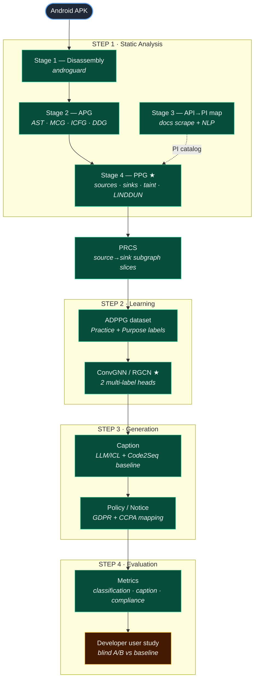

# Privacy Caption / Policy Generation — PPG + ConvGNN

> Given an Android **APK**, automatically generate an accurate, **GDPR/CCPA-compliant,
> human-readable privacy caption → full privacy notice/policy** — by combining static
> program analysis, taint analysis, a privacy-semantic graph, a graph neural network,
> and LLM caption/policy generation.

**Branch:** `stage4-ppg-convgnn` · **Python** 3.14.0 · **Tests:** 69 green · **Real corpus:** 10,721 PRCS from 7 live apps

📊 **[Open the visual dashboard →](docs/dashboard.html)** &nbsp;·&nbsp; 🗂️ [Neo4j display guide](DISPLAY.md) &nbsp;·&nbsp; 📁 [Full spec](docs/PROJECT.md) · [Findings](docs/FINDINGS.md) · [Final report](docs/FINAL_REPORT.md) · [Change log](docs/LEDGER.md)

---

## The idea in one paragraph

Prior work (PriGen, code2seq) captions code by encoding **AST paths** with a **BiLSTM** — a linear
view that loses data-flow context. We instead build a **Privacy Property Graph (PPG)**: program
structure (AST) + call graph (MCG) + control flow (ICFG) + data dependence (DDG) + **taint flows** +
**privacy semantics** (sources, sinks, PI types, LINDDUN threats) — and encode it with a
**relation-aware ConvGNN (RGCN)**. The graph carries the data-flow and privacy context that linear
paths can't, enabling **multi-label Practice + Purpose** classification that feeds caption and
policy generation.

---

## How it works — the pipeline



★ = the novel contributions of this build.

| Stage | What it does | Output |
|---|---|---|
| **1 · Disassembly** | androguard unpacks the APK to dalvik methods/statements | internal graph |
| **2 · APG** | builds 4 graphs: AST (structure), MCG (calls), ICFG (control flow), DDG (data deps) | `{AST,MCG,ICFG,DDG}_{nodes,edges}.csv` |
| **3 · API→PI** | scrapes Android docs + NLP to map each API to the personal info it touches | `personal_info_results.csv` |
| **4 · PPG ★** | overlays privacy semantics on the APG: tags **sources** & **sinks**, propagates **taint** (BFS over DDG/ICFG/CALLS), attaches **LINDDUN** threats | `PPG_nodes/edges.csv`, `ppg.pkl`, `taint_paths.json` |
| **PRCS** | slices a subgraph around every source→sink flow | one JSON per flow |
| **ADPPG** | attaches multi-label **Practice + Purpose** labels (PAcT taxonomy), leakage-free APK-grouped splits | `adppg.jsonl`, `labels.csv`, `splits.json` |
| **ConvGNN ★** | PRCS subgraph → PyG → RGCN → 2 multi-label heads (Practice, Purpose) | `best.pt`, `metrics.csv` |
| **Caption** | turns each labeled flow into a grounded NL caption (pluggable LLM; Code2Seq baseline) | `captions.json/csv` |
| **Policy** | groups captions into a notice + policy, maps to GDPR & CCPA obligations | `notice.md`, `policy.md/json` |
| **Eval** | classification P/R/F1 + caption BLEU/ROUGE (vs references) + policy completeness | `eval_report.md/json` |
| **User study** | blind A/B instrument (PPG vs baseline) + ratings ingestion | `study_packet.md`, `study_metrics.json` |

> **PAcT taxonomy** (both heads multi-label) — **Practice:** Processing · Collecting · Sharing · Other.
> **Purpose:** Functionality · Advertisement · Analytics · Other.

---

## Where we are

### ✅ Built & tested (everything in the pipeline above)
The full method — novel PPG + ConvGNN + caption/policy + eval + user-study instrument +
**Neo4j display** (per-node `what_it_does`, Cypher query library, styling — see [DISPLAY.md](DISPLAY.md)) +
**Stage 8 Privacy Nutrition Facts** (labels + a static viewer app) + a one-command pipeline +
a real-APK adapter — is implemented, reproducible, and covered by **69 tests**.

### 🔬 Real-corpus run (G4 — done)
`pipeline/run_corpus.py` processed **8 AndroZoo APKs fully in-memory** (APG→PPG→PRCS) into
`data/corpus_run/`, producing **10,721 real PRCS** across 7 live apps:

| App | PRCS | App | PRCS |
|---|--:|---|--:|
| Twitter | 4,728 | Snapchat | 1,004 |
| Spotify | 2,712 | Duolingo | 698 |
| Instagram | 626 | WhatsApp | 535 |
| TikTok | 418 | Facebook¹ | 0 |

¹ The AndroZoo `com.facebook.katana` APK is a thin stub/loader (279 classes) → 0 flows; legit, not a bug. Effective corpus = 7 apps.

### Human gates — what's left

| Gate | What it unlocks | Status |
|---|---|---|
| **G4 — APK corpus** | real PRCS at scale | ✅ **done** — 10,721 PRCS from 7 apps |
| **G1 — annotation** | real Practice/Purpose ground truth (replaces WEAK heuristic labels) | 🔄 **in progress** — LLM-assisted labels staged (95.1% two-pass agreement); 13-row human shortlist to verify |
| **G2 — real metrics** | non-bootstrap classification numbers | 🔄 **preliminary** — practice macro-F1 **0.584** / purpose 0.258 on a 100-flow human-labeled TikTok test (labels LLM-derived, await human check) |
| **G3 — user study** | does PPG beat the Code2Seq baseline for developers | ⬜ needs IRB approval + ≥12 developers |

> ⚠️ **No-fabrication rule:** every number computed on WEAK heuristic labels or the synthetic fixture
> carries a `BOOTSTRAP — not a real result` banner (it keys off the **test split only**). The
> preliminary G2 numbers use **LLM-annotated** test labels — real until a human verifies them, then
> we report human–LLM agreement (κ).

**Next:** human-verify the 13-row shortlist + a random sample (→ report κ) → real-LLM caption tuning →
G3 developer study.

---

## Quick start

```bash
pip install -r requirements-stage4.txt

# whole pipeline on the synthetic fixture (no APK, no network, no keys):
python -m pipeline.run_pipeline --apg data/fixtures/synthetic_apg_large --out data/run

# or on a real APK end-to-end:
pip install androguard
python -m pipeline.run_pipeline --apk "Static Code Analysis Module/input/APK/sample.apk" --out data/run_sample

# a corpus of real APKs → one dataset:
python -m pipeline.run_corpus --apks data/corpus --out data/corpus_run --precision

# the G1 → G2 loop (annotate → rebuild → retrain) in one shot:
python run_g1g2.py

# Privacy Nutrition Facts app (Stage 8) — opens data/run/app/index.html:
python -m step4_app.build_app --dataset data/run/dataset --captions data/run/captions --out data/run/app

# Neo4j display — list/inspect the Cypher query library (offline), or --run against a server:
python -m stage4_ppg.cypher_runner --list

# tests:
python -m pytest tests/ -q
```

Individual stages and the real-APK / AndroZoo adapters are documented in
[docs/PROJECT.md §8](docs/PROJECT.md) and the gate handoffs.

---

## Repo map

```
stage4_ppg/      ★ Stage 4 PPG build (catalogs, taint, build_ppg, semantics, neo4j_loader, cypher_runner)
step2_prcs/        PRCS extraction (subgraph per source→sink flow)
step2_dataset/     weak labeler + ADPPG dataset + splits + Codr/annotation export
step2_convgnn/   ★ PyG data + RGCN model + metrics + training
step3_caption/     LLM/ICL caption + Code2Seq baseline
step3_policy/      policy/notice assembly + GDPR/CCPA mapping
step4_eval/        evaluation harness (classification + caption + compliance)
step4_userstudy/   user-study instrument + ratings ingestion
step4_app/         Stage 8 — Privacy Nutrition Facts labels + static viewer app
pipeline/          run_pipeline (one APK) · run_corpus (many APKs → one dataset)
adapters/          run_apg_csv (APK→APG, no Neo4j) · fetch_fdroid · fetch_androzoo
pplib/             shared libs (schema, io, APG adapter)
configs/           sinks · sdk_catalog · ppg · convgnn · gdpr_ccpa_map · llm · weak_labels (YAML) · queries.cypher · neo4j.grass
tests/             69 tests — unit + integration + e2e
data/              apg/ ppg/ prcs/ dataset/ corpus_run/ fixtures/  (gitignored except fixtures)

Static Code Analysis Module/   existing Stage 1–2 (androguard APG → CSV + Neo4j)  — untouched
Document Analysis Module/      existing Stage 3 (API docs → personal_info_results.csv) — untouched
```

## Documentation

| Doc | What's in it |
|---|---|
| **[docs/dashboard.html](docs/dashboard.html)** | 📊 visual showcase — pipeline, stage/gate status, corpus stats |
| [DISPLAY.md](DISPLAY.md) | Neo4j display guide — load an app, style it, run the Cypher query library |
| [docs/PROJECT.md](docs/PROJECT.md) | durable spec — schemas, run order, decisions (single source of truth) |
| [docs/FINDINGS.md](docs/FINDINGS.md) | notable decisions & insights (for the paper) |
| [docs/FINAL_REPORT.md](docs/FINAL_REPORT.md) | what runs vs what's bootstrap, completion estimate |
| [docs/LEDGER.md](docs/LEDGER.md) | append-only chronological build log |
| [docs/handoffs/](docs/handoffs/) | G1–G4 gate handoffs (exact steps + what's needed from you) |
| [docs/archive/PROJECT_PLAN.md](docs/archive/PROJECT_PLAN.md) | superseded original Jain-2022 framing (historical) |
