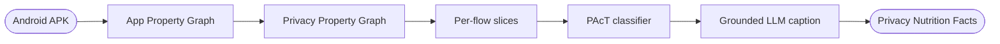
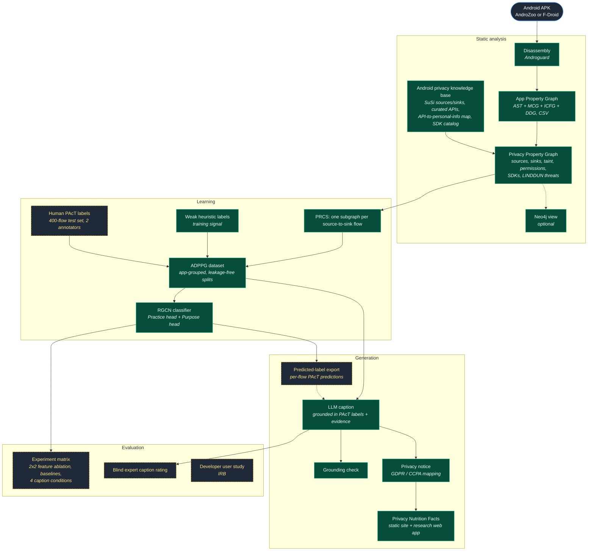

# Privacy Caption Generation

**Explaining what an Android app does with your personal data, derived from the app's own code.**

Privacy policies are written by hand, and they often disagree with what the app actually does. This project generates privacy captions directly from an Android APK. It statically analyzes the app, builds a graph of how personal data moves through the code, and classifies every data flow by *what* the app does with the data and *why*. A large language model then writes a short, plain-English caption grounded in those labels. What is new is the classification step in the middle: a graph neural network labels each flow on the PAcT privacy taxonomy *before* any text is generated, so the caption is constrained by evidence from the code, not only by the model's reading of a snippet. The system aims to produce privacy captions aligned with GDPR and CCPA disclosure requirements and to present them as a Privacy Nutrition Facts label.



## Motivation

- **Policies drift from code.** Privacy policies and app-store data-safety forms are self-reported. Nothing in the developer workflow ties a sentence like "we share your location with advertisers" to the line of code that does it.
- **Code-to-caption generators see too little.** PriGen [2] translates permission-requiring code segments into captions with a code2seq model [5], which reads a method as a bag of AST paths and loses where data goes after it leaves the method. PCapGen [3] gives an LLM larger extracted code context, but the model still has to infer from raw code both what kind of data handling it is looking at and what it is for.
- **The answer to "why" is usually not in one method.** Whether a location read serves maps, analytics or advertising depends on the sink the data reaches and on the SDK that owns that sink. That information lives in the data-flow and call structure across the app, which is exactly what a graph captures.

## Contribution

1. **A Privacy Property Graph for Android.** Four program graphs are extracted from the APK with Androguard: the abstract syntax tree (AST), method call graph (MCG), interprocedural control-flow graph (ICFG) and data-dependence graph (DDG). They are merged into one App Property Graph. On top of it, a privacy overlay marks personal-data sources (from the SuSi catalog [6] plus a curated public-API list), sinks (network, storage, logging, IPC, serialization), interprocedural taint flows with per-edge provenance, Android permissions, third-party SDKs, and LINDDUN threat categories. The name follows Kunz et al.'s Privacy Property Graph [4], which targets source-level privacy threat modeling. This project builds its graph for compiled Android apps and uses it as model input.
2. **PAcT classification before captioning.** Every source-to-sink flow is sliced into a Privacy-Relevant Code Slice (PRCS) subgraph. A relation-aware graph convolutional network (RGCN) with two multi-label heads classifies each slice on the PAcT taxonomy [1]: *Practice* (what is done with the data) and *Purpose* (why).
3. **Captions grounded in PAcT labels.** The LLM receives the Practice and Purpose labels, the personal-data type, the source and sink APIs and the taint path, and is instructed to make no claim outside that evidence. Feeding it the classifier's *predicted* labels for unseen apps is the central experimental condition. A grounding checker flags captions that mention data types, recipients or purposes not present in the evidence.
4. **From captions to a disclosure.** Captions roll up into a per-app privacy notice mapped to GDPR and CCPA disclosure items, and into a Privacy Nutrition Facts label.

**How this differs from PCapGen.** PCapGen extracts code context and asks an LLM to describe the privacy behavior directly. Here the LLM is downstream of an explicit, inspectable classification: the Practice and Purpose of each flow are decided by a model trained on graph structure, and they can be evaluated, audited or corrected independently of the generated text. The evaluation compares the two styles directly: a code-only caption condition against a condition that adds the classifier's predicted labels.

## Pipeline



Green boxes are implemented and run end to end. Dashed amber boxes are planned.

## PAcT taxonomy

Both heads are multi-label: one flow can be, for example, both *Collecting* and *Sharing*, for both *Functionality* and *Analytics*. Label definitions follow Jain et al. [1].

| Head | Label | Meaning |
|---|---|---|
| **Practice** (what) | Processing | The app uses the personal data on the device. |
| | Collecting | The app reads or gathers the personal data. |
| | Sharing | The personal data leaves the app, to a server, third party or other component. |
| | Other | A practice not covered above. |
| **Purpose** (why) | Functionality | Needed for a feature the user asked for. |
| | Advertisement | Used for ads or ad targeting. |
| | Analytics | Used for usage measurement or analytics. |
| | Other | A purpose not covered above. |

## Repository map

| Path | What it does | Status |
|---|---|---|
| [`adapters/`](adapters/) | APK to APG CSVs with Androguard (`run_apg_csv`); APK fetchers for F-Droid (no key) and AndroZoo (API key) | working |
| [`stage4_ppg/`](stage4_ppg/) | Privacy Property Graph builder: source/sink catalogs, taint propagation, per-node `what_it_does` text, optional Neo4j loader and Cypher query runner | working |
| [`step2_prcs/`](step2_prcs/) | Slices one PRCS subgraph per source-to-sink flow, with full provenance | working |
| [`step2_dataset/`](step2_dataset/) | ADPPG dataset: weak labeler, app-grouped splits, annotation sheets and ingest | working |
| [`step2_convgnn/`](step2_convgnn/) | PyTorch Geometric RGCN with Practice and Purpose heads; training and APG-vs-PPG ablation | working |
| [`step3_caption/`](step3_caption/) | Caption generation (offline mock or Anthropic/OpenAI), evidence conditions, grounding checker, untrained code2seq-style placeholder baseline | working |
| [`step3_policy/`](step3_policy/) | Privacy notice and policy assembly with a GDPR/CCPA mapping | working |
| [`step4_app/`](step4_app/) | Privacy Nutrition Facts labels and a static viewer site | working |
| [`webapi/`](webapi/), [`frontend/`](frontend/) | Read-only FastAPI research API and React + Vite front end (see [WEBSITE.md](WEBSITE.md)) | working |
| [`step4_eval/`](step4_eval/) | Classification metrics, text metrics, grounding and LLM-judge harness | partial: human reference data pending |
| [`step4_userstudy/`](step4_userstudy/) | Blind rating packet and ratings ingest | partial: blinding fixes and statistical tests planned |
| [`pplib/`](pplib/) | Shared schema, PAcT label schema, experiment manifests, the experiment matrix and its runner, test-set lock | working |
| [`pipeline/`](pipeline/) | One command per APK (`run_pipeline`) or per corpus (`run_corpus`) | working |
| [`configs/`](configs/) | Editable YAML for the knowledge base, taint, model, LLM, weak labels, GDPR/CCPA map; Cypher library and Neo4j styling | working |
| [`data/knowledge_base/`](data/knowledge_base/) | SuSi source/sink lists and the API-to-personal-information table | working |
| [`data/fixtures/`](data/fixtures/) | Synthetic APG fixtures so the full pipeline and tests run without any APK | working |
| [`research/`](research/) | Design documents: schemas, knowledge base, taint traversal, dataset, model, evaluation plan, limitations | working |
| [`legacy/`](legacy/) | Earlier standalone scripts and working notes, kept for reference | archived |

## Setup and reproduction

Requires **Python 3.14**. Node.js 20+ is needed only for the web front end.

```bash
git clone https://github.com/navong-umd/Privacy-Caption-Generation-Project.git
cd Privacy-Caption-Generation-Project
python -m venv .venv && source .venv/bin/activate      # Windows: .venv\Scripts\activate
pip install -r requirements-dev.txt                     # core pipeline + pytest
cp .env.example .env                                    # fill in only the keys you need
```

Optional extras: `requirements-apk.txt` (Androguard, for real APKs), `requirements-llm.txt` (Anthropic/OpenAI captions), `requirements-neo4j.txt` (Neo4j driver), `requirements-web.txt` (research web app).

### 1. Run the whole pipeline on the synthetic fixture (no APK, no network, no keys)

```bash
python -m pytest tests/ -q
python -m pipeline.run_pipeline --apg data/fixtures/synthetic_apg_large --out data/run
```

`data/run/` then holds every stage's output: `apg/`, `ppg/`, `prcs/`, `dataset/`, `convgnn/`, `captions/`, `policy/`, `eval/` and the Nutrition Facts site in `app/index.html`. Everything computed on fixture or heuristic labels carries a banner saying so.

### 2. Run it on a real APK

APKs are never committed. Fetch open-source apps from F-Droid without a key:

```bash
pip install -r requirements-apk.txt
python -m adapters.fetch_fdroid --packages "org.connectbot" --out data/corpus
python -m pipeline.run_pipeline --apk data/corpus/<downloaded>.apk --out data/run_real
```

For AndroZoo, request an API key at https://androzoo.uni.lu/access, put it in `.env` as `ANDRO_ZOO_KEY`, then:

```bash
python -m adapters.fetch_androzoo --download-index data/androzoo/latest.csv.gz
python -m adapters.fetch_androzoo --index data/androzoo/latest.csv.gz --packages "com.example.app" --out data/corpus_az
python -m pipeline.run_corpus --apks data/corpus_az --out data/corpus_run --precision
```

`run_corpus` processes each APK in memory and builds one dataset with splits grouped by app, so no app appears in both training and test data.

### 3. Real LLM captions

The default caption provider is an offline deterministic template. To use a real model, add `ANTHROPIC_API_KEY` or `OPENAI_API_KEY` to `.env` and cap the number of calls:

```bash
pip install -r requirements-llm.txt
python -m step3_caption.generate --dataset data/run/dataset --out data/run/captions_llm \
    --provider anthropic --limit 20
```

### 4. View the Privacy Property Graph in Neo4j (optional)

```bash
docker run --rm -p 127.0.0.1:7474:7474 -p 127.0.0.1:7687:7687 -e NEO4J_AUTH=neo4j/<your NEO4J_PASSWORD> neo4j:5.26
pip install -r requirements-neo4j.txt
python -m stage4_ppg.build_ppg --apg data/fixtures/synthetic_apg_large --out data/ppg --neo4j
python -m stage4_ppg.cypher_runner --list
```

Choose your own password, put it in `.env` as `NEO4J_PASSWORD`, and use the same one in the command above; the ports are bound to localhost only. [DISPLAY.md](DISPLAY.md) covers styling and the Cypher query library.

### 5. Privacy Nutrition Facts and the research web app

```bash
python -m step4_app.build_app --dataset data/run/dataset --captions data/run/captions --out data/run/app
```

The FastAPI + React research site is described in [WEBSITE.md](WEBSITE.md).

## Evaluation

The evaluation methodology is fixed in the repository. **Results are pending** until the human annotation step is complete; no numbers are reported here.

- **Human annotation.** 400 flows from a held-out app form the test set. Two annotators label 100 of them independently, and agreement is reported as Cohen's kappa per label and per head; each annotator then labels 150 more, and disagreements are adjudicated. A 20-flow calibration round, drawn from outside the test set, comes first. Training continues to use weak heuristic labels.
- **Classification.** Per-label precision, recall and F1, plus micro and macro F1 per head. Four RGCN configurations form a 2x2 ablation (with and without the privacy overlay, with and without code tokens). Each is trained with 5 seeds and reported with 95% intervals and a paired bootstrap against the full model. Rule-based and TF-IDF classifiers are the baselines.
- **Captions.** Four conditions on a fixed 60-flow sample: code only (PCapGen-style input), code plus APIs, code plus taint path, and code plus taint path plus the RGCN's predicted labels. Two expert raters score accuracy, completeness and clarity blind to condition and pick the best caption per flow. A grounding checker reports the hallucination rate per condition.
- **Developer study.** A blind comparison with developers is planned after IRB approval.
- **Provenance.** Every reported number will come from an experiment manifest under `experiments/` that records the locked test set, configuration digest, seed and code version. Labels produced by an LLM are tracked as a separate label source and never counted as human labels.

## Related work

1. V. Jain et al. *PAcT: Detecting and Classifying Privacy Behavior of Android Applications.* ACM WiSec 2022, pp. 104-118. <!-- TODO(Ali): confirm citation (full author list) -->
2. V. Jain, S. D. Gupta, S. Ghanavati, S. T. Peddinti. *PriGen: Towards Automated Translation of Android Applications' Code to Privacy Captions.* RCIS 2021. arXiv:2305.06509.
3. V. Jain, S. Ghanavati, S. T. Peddinti, C. McMillan. *Automated Generation of Accurate Privacy Captions From Android Source Code Using Large Language Models* (PCapGen). arXiv:2601.06276, 2026. <!-- TODO(Ali): confirm ICSE 2026 venue -->
4. I. Kunz, K. Weiss, A. Schneider, C. Banse. *Privacy Property Graph: Towards Automated Privacy Threat Modeling via Static Graph-based Analysis.* PoPETs 2023(2):171-187.
5. U. Alon, S. Brody, O. Levy, E. Yahav. *code2seq: Generating Sequences from Structured Representations of Code.* ICLR 2019.
6. S. Rasthofer, S. Arzt, E. Bodden. *A Machine-learning Approach for Classifying and Categorizing Android Sources and Sinks.* NDSS 2014.
7. M. Schlichtkrull, T. Kipf, P. Bloem, R. van den Berg, I. Titov, M. Welling. *Modeling Relational Data with Graph Convolutional Networks.* ESWC 2018.

## Team

- **Sambathchatovong Na** ([@navong-umd](https://github.com/navong-umd)): project lead; original static-analysis and document-analysis modules.
- **Ali Ferris**: research assistant; Privacy Property Graph, PRCS dataset, RGCN classifier, caption and policy generation, evaluation tooling, research web app.

<!-- TODO(Ali): PI and lab name -->

## Status and roadmap

| Stage | Status |
|---|---|
| APK disassembly and App Property Graph | implemented |
| Privacy Property Graph with taint, permissions, SDKs, LINDDUN | implemented |
| PRCS slicing and ADPPG dataset with app-grouped splits | implemented |
| RGCN PAcT classifier (weak-label training) | implemented |
| LLM captions, grounding check, GDPR/CCPA notice | implemented |
| Privacy Nutrition Facts site and research web app | implemented |
| Label provenance (human vs LLM vs weak) and annotation kit | in progress |
| Captions conditioned on the RGCN's predicted labels | implemented |
| Human PAcT annotation, 400 flows, two annotators | planned |
| Experiment matrix with seeds, intervals and baselines | implemented, awaits the locked human test split |
| Blind expert caption rating | planned |
| Public web deployment and GitHub Pages site | planned |
| IRB developer study | planned |

## License

Code is released under the [MIT License](LICENSE). Third-party data and attributions are listed in [NOTICE.md](NOTICE.md).
